<div align="center">

# PathAI: AI-Driven Skill-to-Career Pathway Predictor

**A full-stack AI career intelligence platform that turns a student's real, measured skills into Sri Lanka-specific career matches, LKR salary projections, and a business-ready project plan.**

Built for **SLIIT Ignite Innovation 2026** · MERN stack · Google Gemini AI · GitHub API


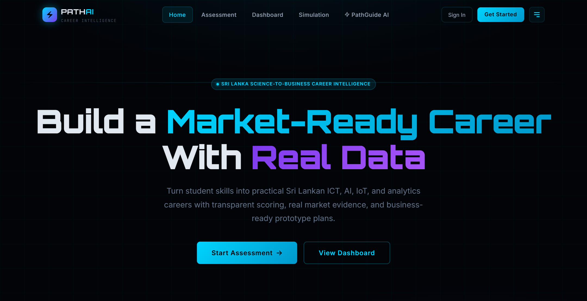

</div>

---

## At a glance

| | Summary |
|---|---|
| **What it is** | A web platform where a student completes a practical skill check, optionally connects GitHub, and gets ranked career matches backed by Sri Lankan market data, plus an AI advisor and an AI-scored workplace simulation. |
| **My role** | Lead full-stack developer: system design, REST API, data model, matching and scoring algorithms, GitHub analysis engine, Gemini AI integration, React UI, security hardening. |
| **Stack** | React 19, Vite, Tailwind CSS 4, Framer Motion, Recharts · Node.js, Express 5, MongoDB with Mongoose · Google Gemini REST API · GitHub REST API · JWT and bcrypt |
| **Scale** | About 9,400 lines of code · 34 REST endpoints · 5 data models · 7 app pages · 11-check skill diagnostic |
| **AI features** | Personalised career chatbot, AI-generated workplace scenarios, and AI grading with written feedback. Every AI feature has a working offline fallback. |

---

## The problem

Sri Lankan IT students usually choose a career path from word of mouth. Very few can answer questions like:

- Which roles actually match **what I can do today**, not just what I say I like?
- What does that role pay **in LKR**, and who is hiring for it locally?
- How far am I from being job-ready, and what exactly should I learn next?
- Can my skills become a **product a local business would pay for**?

PathAI answers all four in one flow. It measures skills through task-based questions (not self-ratings), reads real evidence from GitHub, scores every career with a transparent weighted model, and adds a market and commercial layer built from SLASSCOM, the Export Development Board and the Department of Census and Statistics.

---

## Product tour

All screenshots below are from the running application with live Gemini AI responses, captured with a demo student account.

### 1. Practical skill check: evidence instead of self-rating

Instead of asking "rate your SQL from 1 to 5", the assessment asks what the student can actually **deliver** in a realistic Sri Lankan project situation. Each of the 11 checks is weighted across several skills, and the answers are converted into measured skill levels (1-5) used by the matching engine.

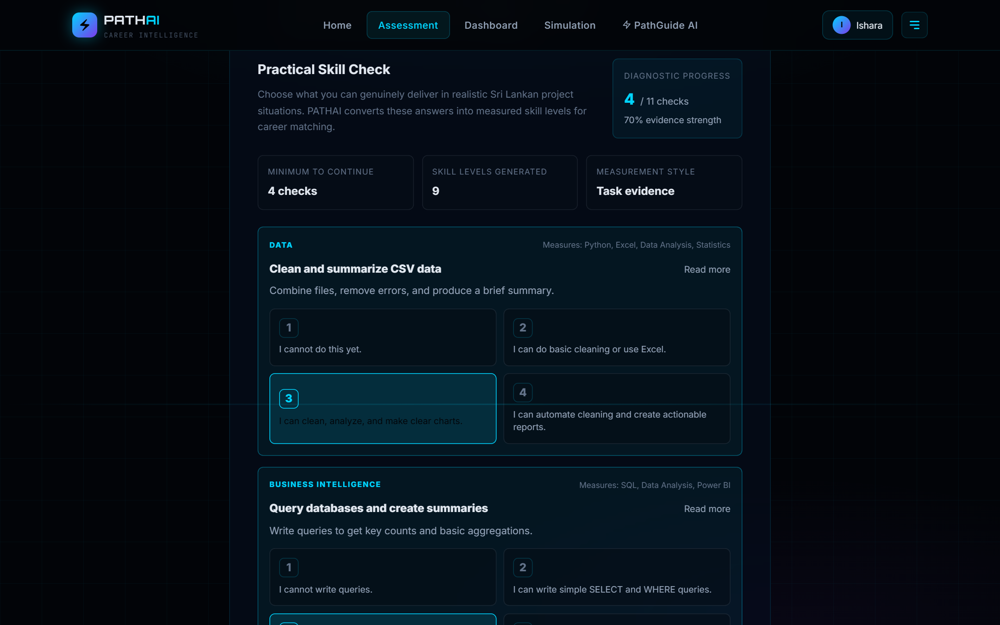

### 2. Passive skill extraction from GitHub

Paste a GitHub username or URL and the backend analyses the public profile and repositories. It aggregates languages, maps them to career domains, and computes a **0-100 Technical Aptitude Score** from seven weighted signals. The result is saved to the student's assessment, and the detected languages count as skills in career matching.

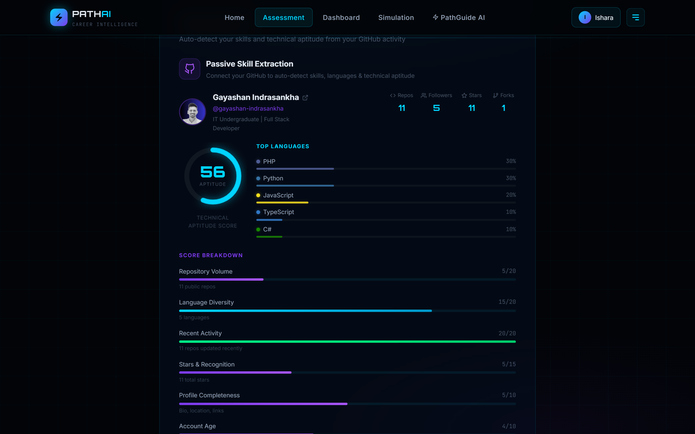

### 3. Market-fit wizard

The student picks a real problem domain (EdTech, AgriTech and IoT, SME tools, Cybersecurity) and how they would prove their skills. These choices become career-matching signals.

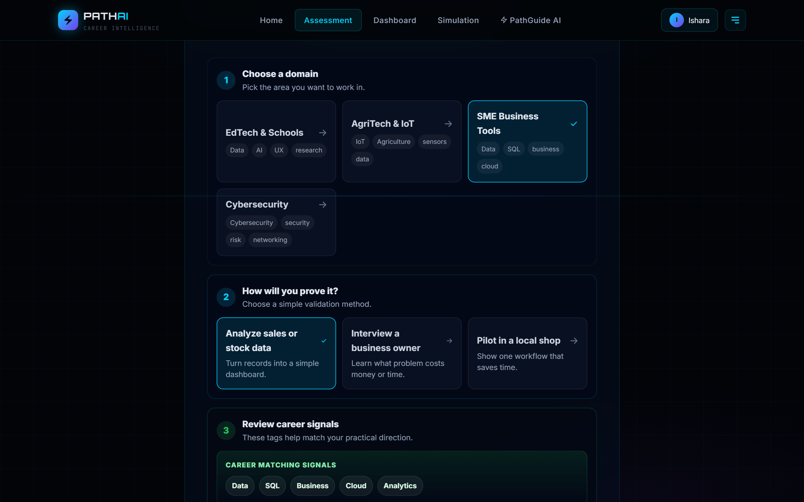

### 4. Ranked, explainable career matches

Each career gets a match score and a confidence level. Nothing is a black box: the student sees exactly which required skills are strengths and which are gaps.

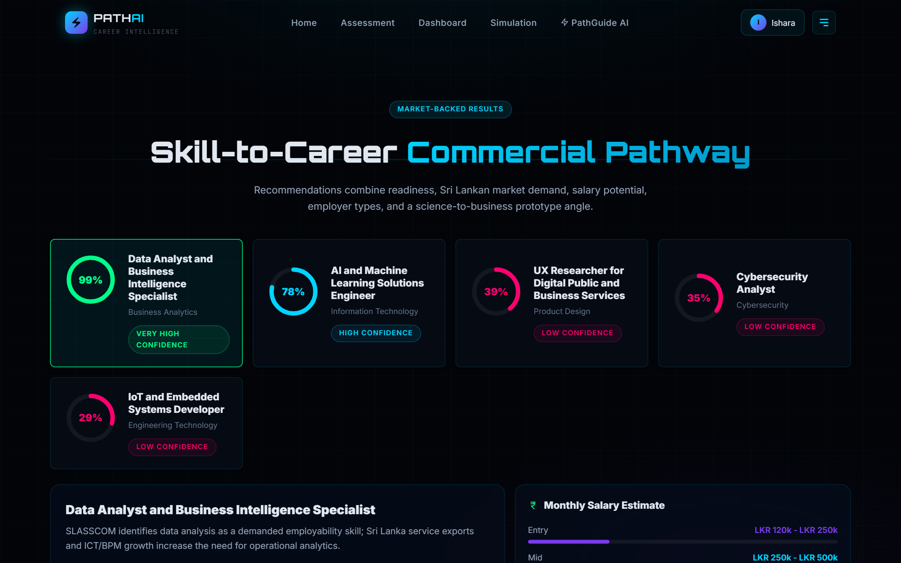

For the selected career, the results page shows likely employers, business use cases, strengths, skill gaps, a prototype pitch with build cost and revenue model, an LKR salary comparison chart, and the market sources behind the data.

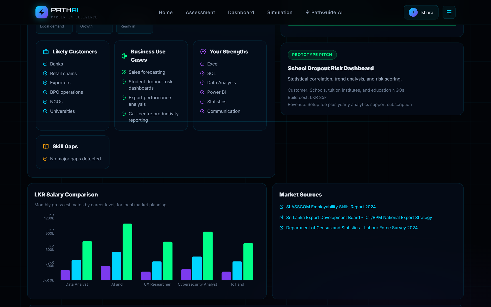

### 5. Personal dashboard

A live summary of the student's top matches, detected skills, growth potential and recommended next steps.

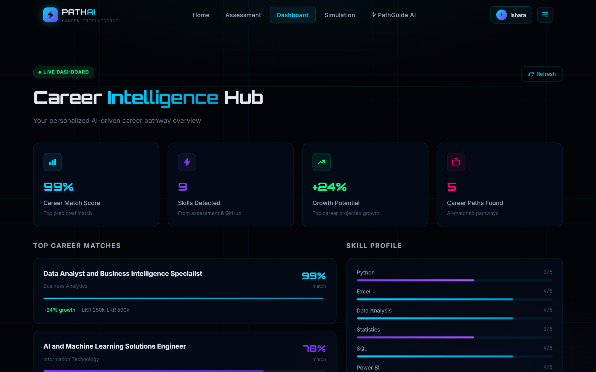

### 6. Career commercial simulator

Models the path from today's skills to a job and a commercial pilot: readiness score, months to job-ready, projected monthly salary in LKR, prototype investment, pilot revenue range, break-even period, and a month-by-month plan.

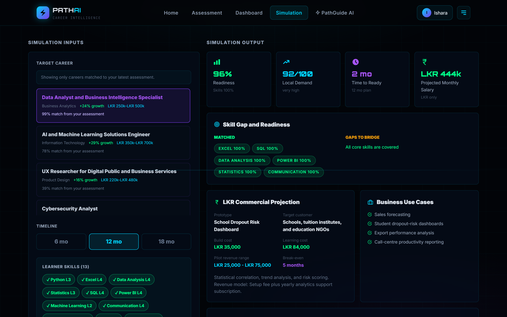

### 7. AI workplace simulation, graded by Gemini

Gemini generates a realistic Sri Lankan workplace scenario for the chosen career. The student writes a solution, and the AI grades it on scientific accuracy, implementation, customer value, LKR cost awareness and risk handling, with strengths, improvements and an ideal approach.

<p align="center">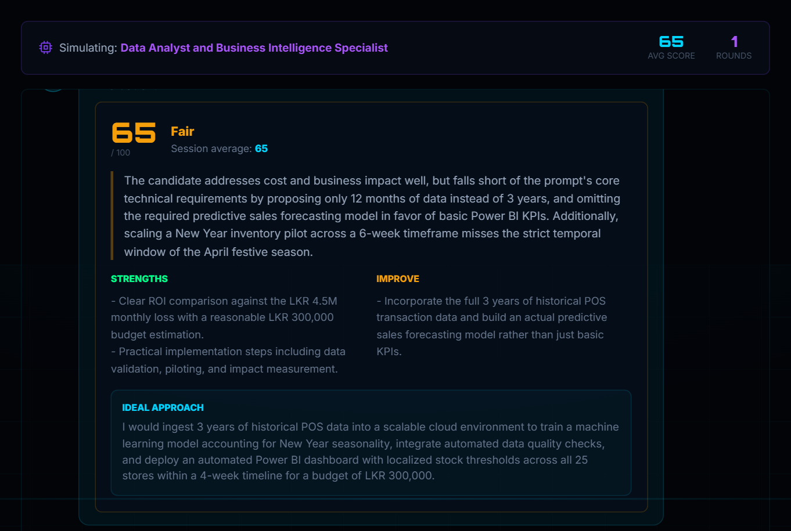</p>

### 8. PathGuide AI: a career advisor that knows the student

A Gemini-powered chatbot that receives the student's assessment profile with every message: measured skills, GitHub languages, interests and predicted careers. Its advice is specific to that student, not generic.

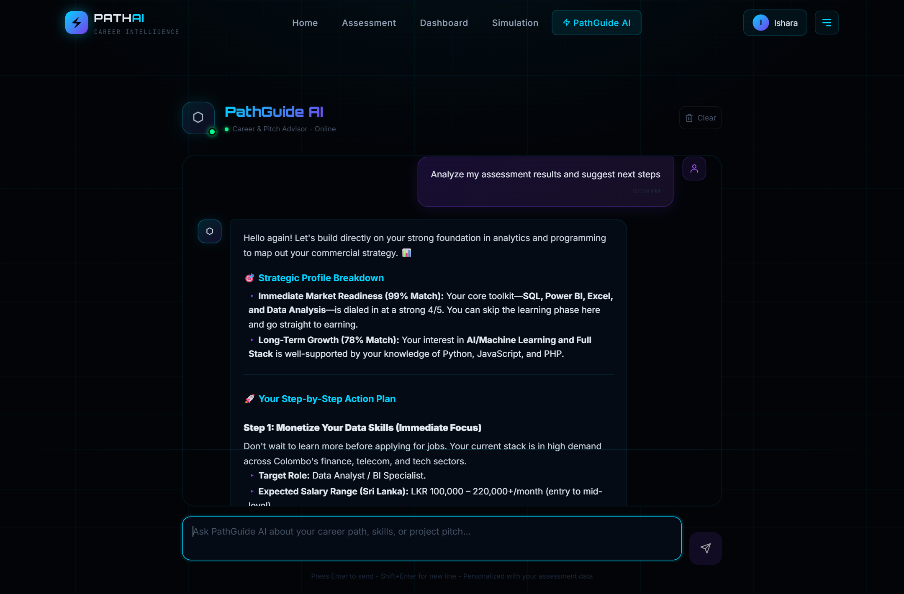

---

## System architecture

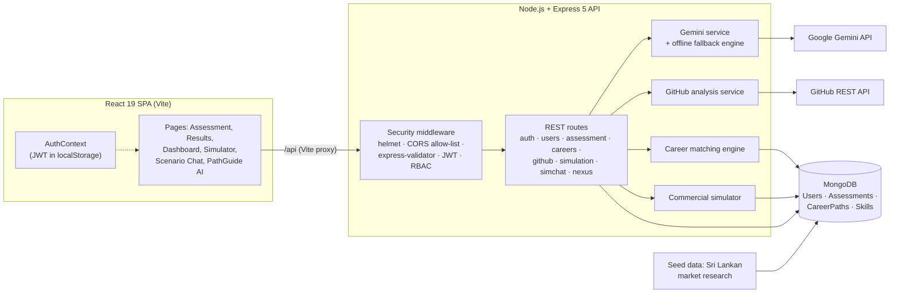

### Assessment-to-results flow

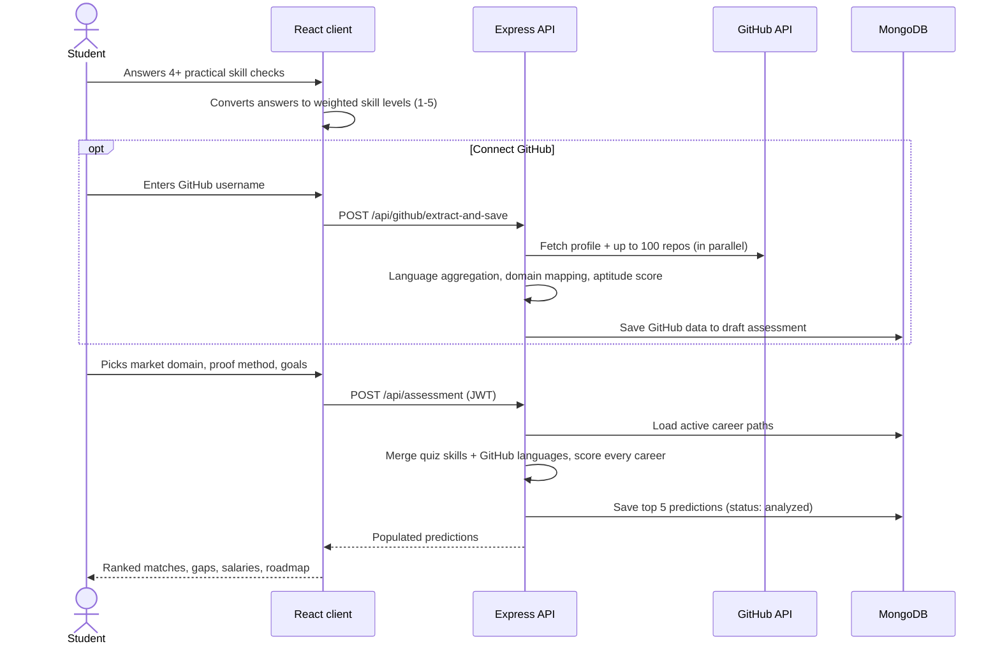

### Data model

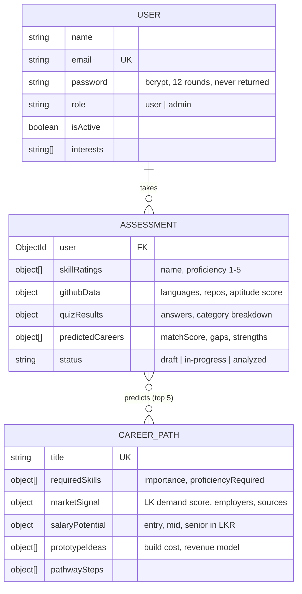

---

## How the algorithms work

### Career match score (0-100)

Every active career is scored against the student's merged skill profile: quiz-measured skills, plus GitHub languages converted to a 1-5 level. A GitHub signal can raise a skill but never lowers a self-measured one.

| Component | Max points | How it is calculated |
|---|---:|---|
| Skill fit | 58 | For each required skill: `importance × min(1, userLevel ÷ requiredLevel)`, normalised by total importance |
| Interest alignment | 16 | 4 points per career tag matching the student's interests and market signals |
| Sri Lankan market demand | 16 | `sriLankaDemandScore ÷ 100 × 16`, from the market dataset |
| Work-style match | 5 | Remote, hybrid or on-site preference matches the role |
| Career-goal match | 5 | The student's written goal mentions the career's domain |
| Industry preference | 3 | Preferred industry matches |

The total is capped at 100 and mapped to a confidence level (very high ≥ 80, high ≥ 60, medium ≥ 40). Missing or under-level skills become **skill gaps**, and a time-to-ready estimate is derived from the number of gaps and their size.

### GitHub technical aptitude score (0-100)

| Signal | Max | Signal | Max |
|---|---:|---|---:|
| Repository volume | 20 | Stars and recognition | 15 |
| Language diversity | 20 | Profile completeness | 10 |
| Recent activity (last 6 months) | 20 | Account age | 10 |
| Original repos with descriptions | 5 | | |

Results are cached in memory for 10 minutes to stay within GitHub's rate limits.

### Commercial simulator

- **Readiness** = 58% skill fit + 24% local market demand + 18% commercial potential
- **Projected salary** interpolates within the career's entry or mid LKR band based on readiness
- **Break-even** = (prototype build cost + learning and certification cost) ÷ conservative monthly pilot revenue
- The career's pathway steps are rescaled to the chosen 6, 12 or 18-month timeline

---

## AI engineering

I treated the AI as a component that **will** fail sometimes, and designed around that.

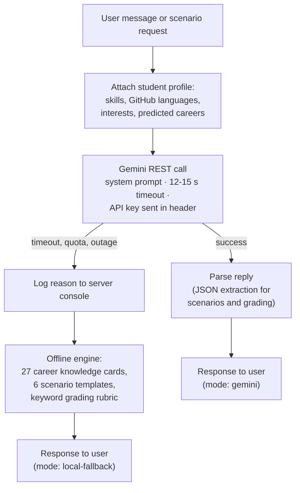

- **Grounded prompts.** A system instruction fixes the advisor's role, enforces Sri Lankan context and LKR-only figures, and restricts topics to careers and learning.
- **Personalisation.** The student's latest analysed assessment is sent with every chat request, so advice refers to their actual ratings and matches. It is prepended to each request rather than stored, so it survives page reloads and history trimming.
- **Structured output.** Scenario generation and answer grading return strict JSON (score, grade, strengths, improvements, ideal approach), which the UI renders as scorecards.
- **Graceful degradation.** If Gemini is slow, rate-limited or unavailable, users still get a useful answer from the built-in engine. The demo never shows a broken screen.
- **Model choice by measurement.** Pinned model versions get retired. I queried the Gemini models API with the project key and benchmarked candidates: the full Flash models were overloaded or took 8-100 seconds, while `gemini-flash-lite-latest` answered in 1.5-2.5 seconds every time. The model is configurable through `GEMINI_MODEL`.

---

## Security and code quality

| Area | What is implemented |
|---|---|
| Authentication | JWT (7-day expiry), bcrypt password hashing with 12 salt rounds, password field excluded from every query by default |
| Authorisation | `requireAdmin` middleware that checks the role **in the database** on each request, so a demoted admin loses access immediately; it protects every career and skill write route |
| Mass-assignment protection | Request bodies are whitelisted, so clients cannot set `role`, `isActive`, assessment owner, status or computed predictions |
| Account lifecycle | Soft-delete deactivation; deactivated accounts are blocked at login and their existing tokens stop working immediately |
| Input validation | `express-validator` on auth, profile, career and assessment routes; GitHub usernames validated against GitHub's own format rules |
| Transport and headers | `helmet` security headers, CORS allow-list, 10 MB body limit |
| XSS | AI replies are HTML-escaped before rendering, so model output can never run as markup in the browser |
| Secrets | API keys only in a git-ignored `.env`; the Gemini key travels in a request header, not the URL |
| Abuse and cost control | Per-user/IP rate limits on every Gemini-backed route, and a server-side guest chat quota |
| Errors | Central error handler mapping Mongoose validation, cast and duplicate-key errors and JWT errors to clean HTTP status codes |

---

## Challenges I solved

- **AI silently not working.** The chatbot appeared to work, but every reply came from the fallback engine because the configured Gemini model had been retired. I added fallback logging, traced the real error, then benchmarked the models available to the key and switched to the fastest reliable one.
- **Chatbot forgetting the student.** The profile was only sent on the first message of a server-side conversation, so after a page reload the AI asked students for details it already had. I moved it into every request.
- **Results that did not add up.** The dashboard paired the highest-demand careers with match scores by list position, so a 99% score appeared next to the wrong career. It now reads each prediction directly.
- **Unfair scoring.** The original quiz never measured 12 of the skills the careers require (Statistics, Communication, Linux and others), so even a perfect candidate capped at 73%. I redesigned the diagnostic to 11 weighted checks covering every required skill, and fed GitHub languages into matching.
- **Security gaps.** I found and closed privilege escalation (any user could create an admin account or edit careers), mass assignment on assessments, and a sign-up flow that locked users out with a random hidden password.

---

## API overview

<details>
<summary><b>34 REST endpoints (click to expand)</b></summary>

| Method | Endpoint | Auth | Purpose |
|---|---|---|---|
| POST | `/api/auth/register` | Public | Create account, returns JWT |
| POST | `/api/auth/login` | Public | Log in, returns JWT |
| GET / PUT / DELETE | `/api/users/me` | User | Read, update or deactivate profile |
| PUT | `/api/users/me/grades`, `/api/users/me/interests` | User | Update grades or interests |
| POST | `/api/assessment` | User | Submit assessment and run career matching |
| GET | `/api/assessment/my`, `/api/assessment/my/latest`, `/api/assessment/:id` | User | Assessment history |
| PATCH | `/api/assessment/:id` | User | Edit a draft assessment (whitelisted fields) |
| POST | `/api/assessment/:id/reanalyze` | User | Re-run matching against current career data |
| GET | `/api/careers`, `/api/careers/:idOrSlug` | Public | Browse and filter careers (paginated, text search) |
| GET | `/api/careers/predicted` | User | The student's latest predictions |
| POST / PUT / DELETE | `/api/careers`, `/api/careers/:id` | Admin | Manage career paths |
| GET / POST | `/api/skills` | Public / Admin | Skill catalogue |
| GET | `/api/github/analyze/:username` | Public | Analyse a GitHub profile |
| POST | `/api/github/extract-and-save` | User | Analyse and save to assessment |
| POST | `/api/simulation/run` | Optional | Commercial simulation |
| POST | `/api/simchat/start`, `/answer`, `/next` · GET `/history` | Optional | AI scenario simulation |
| POST / DELETE | `/api/nexus/chat` · POST `/api/nexus/chat/guest` | User / Public | PathGuide AI chat |
| GET | `/api/health` | Public | Service and database status |

</details>

---

## Tech stack

| Layer | Technologies |
|---|---|
| Frontend | React 19, React Router 7, Vite 8, Tailwind CSS 4, Framer Motion, Recharts, React Icons |
| Backend | Node.js, Express 5, Mongoose 9, express-validator, helmet, cors, morgan |
| Database | MongoDB (embedded sub-documents, text and compound indexes) |
| AI and integrations | Google Gemini REST API (chat, generation, grading), GitHub REST API |
| Auth and security | JSON Web Tokens, bcryptjs, role-based access control |
| Tooling | ESLint, nodemon, concurrently, Git |

## Project structure

```
├── client/                      React frontend (Vite)
│   └── src/
│       ├── pages/               Home, Assessment, ResultsDashboard, Dashboard,
│       │                        CareerSimulation, SimulationChat, NexusChat
│       ├── components/          GitHubExtractor, AuthModal, MarketFitWizard, layout
│       └── context/             AuthContext (session state)
├── server/                      Express API
│   ├── routes/                  9 route modules (34 endpoints)
│   ├── models/                  User, Assessment, CareerPath, Career, Skill
│   ├── services/                geminiService, githubService
│   ├── middleware/              JWT protect + requireAdmin
│   ├── data/                    Sri Lankan career market dataset
│   └── scripts/seedCareers.js   Database seeding
└── docs/screenshots/            README images
```

---

## Run it locally

**Prerequisites:** Node.js 18+, MongoDB 6+, and optionally a free [Gemini API key](https://aistudio.google.com/app/apikey).

```bash
git clone https://github.com/gayashan-indrasankha/AI-Driven-Skill-to-Career-Pathway-Predictor.git
cd AI-Driven-Skill-to-Career-Pathway-Predictor
npm install && npm install --prefix client
```

Create a `.env` file in the project root:

```env
MONGO_URI=mongodb://localhost:27017/career_pathway_db
JWT_SECRET=replace_with_a_long_random_string
CLIENT_URL=http://localhost:5173
GEMINI_API_KEY=your_key_here          # optional: without it, AI features use the offline engine
GEMINI_MODEL=gemini-flash-lite-latest
GITHUB_TOKEN=                         # optional: raises the GitHub rate limit
TRUST_PROXY=                          # set to 1 only when running behind nginx/a reverse proxy
```

Seed the career data and start both servers:

```bash
npm run seed
npm run dev
```

Open http://localhost:5173. The API runs on http://localhost:5000, and `/api/health` reports database status.

Run the API test suite (needs MongoDB; it uses and then drops a separate `career_pathway_test` database):

```bash
npm test
```

---

## Market data sources

The career dataset (demand scores, LKR salary bands, employer types, business use cases) is built from:

- [Sri Lanka Export Development Board: ICT/BPM National Export Strategy](https://www.srilankabusiness.com/national-export-strategy/nes-ict-bpm.html)
- [SLASSCOM Employability Skills Report 2024](https://slasscom.lk/wp-content/uploads/2024/07/SLASSCOM-EMPLOYABILITY-SKILLS-REPORT-2024.pdf)
- [Department of Census and Statistics: Labour Force Survey 2024](https://www.statistics.gov.lk/Resource/en/LabourForce/Annual_Reports/LFS2024.pdf)
- [Sri Lanka services exports 2024 (EconomyNext)](https://economynext.com/sri-lanka-services-exports-us3467mn-in-2024-up-8-5-pct-201665/)
- [SLASSCOM Future Careers Bridge](https://old.slasscom.lk/slasscoms-new-future-careers-bridge-fcb-platform-opens-pathways-to-ict-careers-for-sri-lankas-youth/)

## Roadmap

- UI tests (React Testing Library); the API already has an automated suite (`npm test`)
- Persist chat and simulation sessions in MongoDB instead of server memory
- Rate limiting on authentication and AI endpoints
- Responsive navigation for small screens
- Expand the career dataset beyond the current 6 Sri Lanka-focused pathways

---

## Team

| Name | Role |
|---|---|
| **[Gayashan Indrasankha](https://github.com/gayashan-indrasankha)** | Lead full-stack developer: architecture, backend API, algorithms, AI and GitHub integrations, frontend, security |
| **[Pasindu Dhanushka](https://github.com/Pasindu-Dhanushka)** | Contributor: chatbot improvements, registration and assessment UI fixes |

<div align="center">

**Gayashan Indrasankha** · IT Undergraduate · Full-Stack Developer

[](https://github.com/gayashan-indrasankha)

*If this project interests you, I'd be glad to walk you through the code and design decisions.*

</div>
